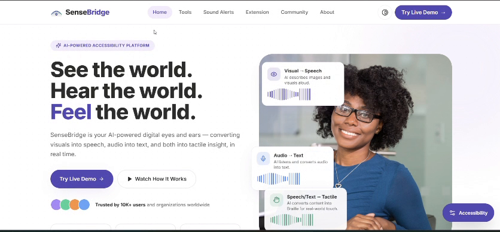
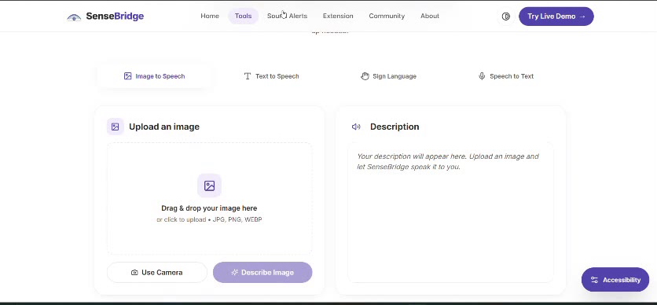
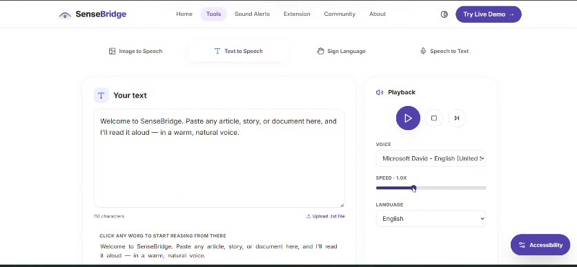
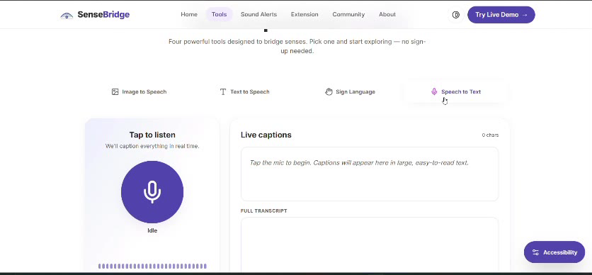
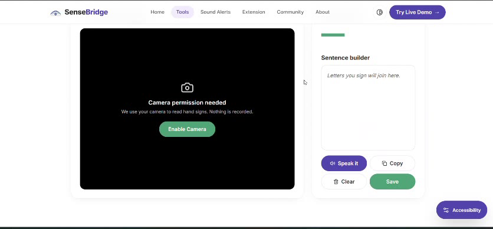
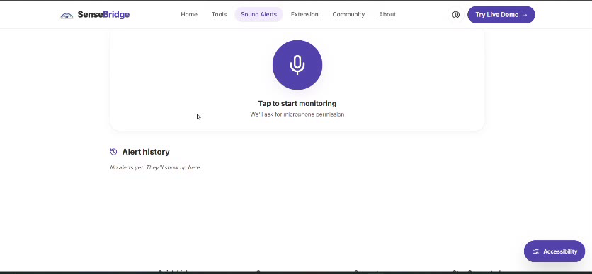
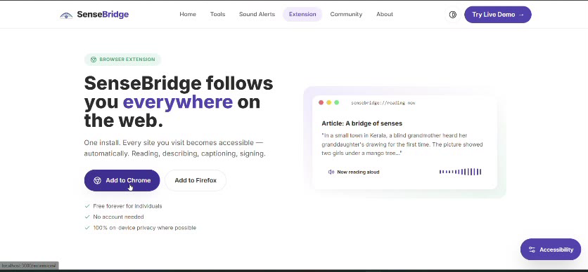
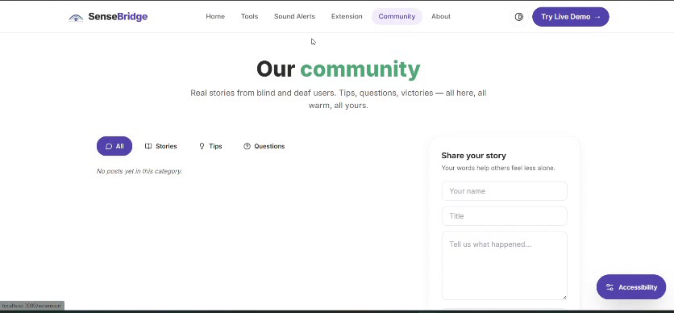

# 🌉 SenseBridge — Your Digital Eyes & Ears

> AI-powered accessibility platform for blind, deaf, and deaf-blind users.  
> Converts visuals into speech, audio into text, and both into tactile insight — in real time.



---

## ✨ Features

- 🖼️ **Image to Speech** — Upload any image and AI describes it aloud in rich detail
- 🔊 **Text to Speech** — Paste any text and hear it read in multiple languages
- 🤟 **Sign Language** — Camera detects hand signs and builds sentences *(prototype)*
- 🎤 **Speech to Text** — Live captions with full transcript save/download
- 🔔 **Sound Alerts** — Detects fire alarms, sirens, doorbells and flashes screen *(prototype)*
- 🌐 **Browser Extension** — Makes any website accessible with one install
- 👥 **Community** — Share stories, tips and questions
- ♿ **Accessibility Toolbar** — Dark mode, high contrast, font size, language switcher

---

## 📸 Screenshots

| Image to Speech | Text to Speech |
|:---:|:---:|
|  |  |

| Speech to Text (live captions) | Sign Language *(prototype)* |
|:---:|:---:|
|  |  |

| Sound Alerts *(prototype)* | Browser Extension |
|:---:|:---:|
|  |  |

| Community |
|:---:|
|  |

---

## 🗂️ Project Structure

```
sensebridge/
├── .gitignore
├── LICENSE
├── README.md
├── docs/
│   └── screenshots/          # Images used in this README
├── backend/
│   ├── .env.example          # Copy to .env and fill in
│   ├── requirements.txt      # Python dependencies
│   └── server.py             # FastAPI backend (all /api routes)
│
└── frontend/
    ├── .env.example          # Copy to .env
    ├── package.json
    ├── tailwind.config.js
    ├── public/
    │   ├── index.html
    │   └── sensebridge-extension.zip   # Browser extension download
    └── src/
        ├── App.js
        ├── index.css          # Global styles + dark mode variables
        ├── api/
        │   └── sensebridgeApi.js        # All API calls
        ├── context/
        │   └── AccessibilityContext.jsx # Global accessibility state
        ├── components/
        │   ├── Navbar.jsx
        │   ├── Footer.jsx
        │   ├── Logo.jsx
        │   ├── AccessibilityToolbar.jsx
        │   ├── ImageToSpeech.jsx
        │   ├── TextToSpeech.jsx
        │   ├── SignLanguage.jsx
        │   └── SpeechToText.jsx
        └── pages/
            ├── Home.jsx
            ├── Tools.jsx
            ├── SoundAlerts.jsx
            ├── AIVision.jsx
            ├── Extension.jsx
            ├── Community.jsx
            └── About.jsx
```

---

## 🚀 Getting Started

### Prerequisites

- Python 3.9+
- Node.js 18+
- MongoDB (local or Atlas)

---

### 1. Clone the project

```bash
git clone https://github.com/Paya1l/sensebridge.git
cd sensebridge
```

---

### 2. Backend Setup

```bash
cd backend

# Create virtual environment
python -m venv venv

# Activate it
# Windows:
venv\Scripts\activate
# Mac/Linux:
source venv/bin/activate

# Install dependencies
pip install -r requirements.txt

# Create your .env file from the example, then add your Gemini key
cp .env.example .env      # Windows: copy .env.example .env
```

**`backend/.env`**
```
MONGO_URL="mongodb://localhost:27017"
DB_NAME="sensebridge"
CORS_ORIGINS="http://localhost:3000"
GEMINI_API_KEY=your_gemini_api_key_here
```

> `CORS_ORIGINS` is a comma-separated list of allowed origins. Set it to your own domain when deploying.

```bash
# Run the backend
uvicorn server:app --port 8001 --reload
```

Backend runs at → `http://localhost:8001`  
API docs at → `http://localhost:8001/docs`

---

### 3. Frontend Setup

```bash
cd frontend

# Install dependencies
npm install

# Create your .env file from the example
cp .env.example .env      # Windows: copy .env.example .env
```

**`frontend/.env`**
```
REACT_APP_BACKEND_URL=http://localhost:8001
```

```bash
# Start the frontend
npm start
```

Frontend runs at → `http://localhost:3000`

---

## 🧩 Browser Extension Install

1. Download `sensebridge-extension.zip` from the Extension page
2. Unzip it to a folder
3. Open Chrome → go to `chrome://extensions`
4. Enable **Developer Mode** (top right toggle)
5. Click **Load unpacked** → select the unzipped folder
6. Pin SenseBridge to your toolbar ✅

### Extension Features (No API needed)
| Feature | Method |
|---------|--------|
| Read page aloud | Browser `speechSynthesis` |
| Live captions | `webkitSpeechRecognition` |
| Read image alt text | Reads `alt` / `aria-label` attributes |
| High contrast | Injects CSS into page |
| Dark mode | CSS invert trick |
| Hover to read | Speaks element text on hover |
| Font size control | Injects `font-size` CSS |

---

## 🛠️ Tech Stack

| Layer | Technology |
|-------|-----------|
| Frontend | React 19, Tailwind CSS, Framer Motion |
| Backend | FastAPI, Python, Motor (async MongoDB) |
| Database | MongoDB |
| AI / LLM | Google Gemini |
| Text to Speech | gTTS (server), Web Speech API (browser) |
| Speech to Text | Web Speech API |
| Extension | Manifest V3, Vanilla JS |

---

## 🧱 How I Built It

SenseBridge is a full-stack web app with three parts that talk to each other:

```
Browser (React)  ──HTTP──▶  FastAPI backend  ──▶  MongoDB
      │                          │
      │                          └──▶  Google Gemini (image descriptions)
      └── Web Speech API / Camera / Microphone (runs on-device)
```

**1. Frontend (React 19 + Tailwind CSS)**
- Pages are routed with React Router: Home, Tools, Sound Alerts, AI Vision, Extension, Community, About.
- Each tool is its own component (`ImageToSpeech`, `TextToSpeech`, `SpeechToText`, `SignLanguage`).
- An `AccessibilityContext` stores user settings (dark mode, high contrast, font size, language) and applies them across the whole app.
- Speech-to-text uses the browser's built-in Web Speech API, so voice never leaves the device.

**2. Backend (FastAPI + Python)**
- All routes live in `backend/server.py` under `/api`.
- `/image-to-speech` resizes the uploaded image and sends it to Gemini (`gemini-2.0-flash`) to get a description.
- `/text-to-speech` uses gTTS to turn text into audio in the selected language.
- `/transcripts` and `/community` save and load data from MongoDB using Motor (async driver).
- Secrets such as the Gemini key are read from a `.env` file and are never committed.

**3. Browser Extension (Manifest V3, vanilla JS)**
- A separate extension in `frontend/public/sensebridge-extension.zip` that adds accessibility features to any website.

### ✅ What is real vs. prototype

| Feature | Status |
|---------|--------|
| Image to Speech | Working, uses Gemini |
| Text to Speech | Working, uses gTTS |
| Speech to Text / live captions | Working, uses Web Speech API |
| Community, transcripts | Working, saved in MongoDB (community starts empty) |
| Accessibility toolbar | Working |
| Sign Language | **Prototype**: camera works, but letter detection is simulated |
| Sound Alerts | **Prototype**: microphone works, but classification is a simple in-browser frequency heuristic, not a trained model |

The two prototype features are planned to use trained models (MediaPipe + TensorFlow.js for hand signs, YAMNet for sounds). See the AI Vision page for the roadmap.

### 🤖 Development note
This project was built with the help of AI coding tools. I'm using it to learn full-stack development by reading, running, and modifying each part.

---

## 🌍 Supported Languages

- English
- हिन्दी (Hindi)
- ગુજરાતી (Gujarati)
- தமிழ் (Tamil)
- తెలుగు (Telugu)

---

## 👥 Community

SenseBridge has a built-in community where users share:
- 📖 **Stories** — experiences using the platform
- 💡 **Tips** — tricks and best practices
- ❓ **Questions** — help and discussion

---

## 📄 License

MIT — see [LICENSE](LICENSE).

---

## 💜 Made with care for 750+ million people living with sensory disabilities worldwide.